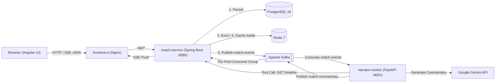

# Live Match Center (xG & AI Commentary Engine)

[](https://github.com/JoaoTS20/live-match-center-xg/actions/workflows/ci.yml)

An event-driven football telemetry platform that ingests live pitch events, calculates Expected Goals (xG) in real time, generates context-aware AI play-by-play commentary using match history, and streams updates to connected browsers over Server-Sent Events (SSE).

---

## Architecture



### Event Lifecycle
1. **Ingest (`POST /api/v1/events`)**: `match-service` validates the event (`SHOT`, `GOAL`, `PASS`, `FOUL`, `SAVE`; minute `0–130`), persists it to PostgreSQL, synchronously evicts the match's Redis cache entry, and publishes the event to Kafka (`match-events`).
2. **Analyze & Narrate**: `narrator-worker` consumes `match-events`, filters for key moments (`SHOT`, `GOAL`), computes **xG** from pitch coordinates `(x, y)`, and invokes a Gemini agent equipped with a `get_match_history` tool.
3. **Cache-Aside Read (`GET /api/v1/events/{matchId}`)**: The narrator's tool call hits `match-service`, which checks Redis first (30-minute TTL) and falls back to PostgreSQL using a composite index `(match_id, minute, created_at)` for deterministic chronological ordering.
4. **Live Broadcast (`GET /api/v1/matches/{matchId}/stream`)**: `narrator-worker` publishes the enriched commentary to `match-commentary`. Every `match-service` replica consumes the topic under its own per-pod consumer group (`match-service-sse-${HOSTNAME:local}`) and pushes live updates to connected Angular clients via SSE.

---

## Tech Stack

| Component | Technology | Responsibility |
| :--- | :--- | :--- |
| **`frontend-ui`** | Angular, RxJS, Nginx | Interactive football pitch, event submission, reverse proxy, auto-reconnecting SSE feed |
| **`match-service`** | Java, Spring Boot, JPA, Spring Cache, Actuator | Event ingestion API, PostgreSQL persistence, Redis cache management, Kafka producer & SSE fan-out |
| **`narrator-worker`** | Python, FastAPI, `aiokafka`, `httpx`, `google-genai` | Async Kafka worker, xG calculation, LLM tool-calling commentary agent, consumer-aware health probe |
| **Database** | PostgreSQL 16 | System of record for match timelines (`StatefulSet` + Persistent Volume in Kubernetes) |
| **Cache** | Redis 7 | Cache-Aside layer for fast timeline lookups with graceful DB fallback on outages |
| **Message Broker** | Apache Kafka 3.9 | Decoupled event streaming (`match-events` and `match-commentary` topics) |
| **Orchestration** | Docker Compose & Kubernetes | Local multi-container dev stack and production-style K8s manifests (`live-match-center`) |

---

## Production Hardening Highlights

* **Strict Write Ordering**: `match-service` executes `DB commit → Redis evict → Kafka publish` synchronously so `narrator-worker` never reads stale cached timelines when triggered by Kafka.
* **Graceful Redis Degradation**: A custom `CacheErrorHandler` and `management.health.redis.enabled=false` ensure Redis outages fall back transparently to PostgreSQL without marking `match-service` unhealthy.
* **Horizontal SSE Scaling**: Using `spring.kafka.consumer.group-id=match-service-sse-${HOSTNAME:local}` ensures every scaled replica of `match-service` receives all commentary broadcasts regardless of which pod holds a user's SSE stream.
* **Zero-Downtime Rollouts**: `match-service` combines `server.shutdown=graceful`, `@PreDestroy` SSE stream completion, and Kubernetes `RollingUpdate` (`maxUnavailable: 0`, `maxSurge: 1`) with 3-tier `startup`/`readiness`/`liveness` probes.
* **Self-Healing Worker & Client**: `narrator-worker`'s `/health` endpoint returns `503` if the background Kafka consumer task exits (triggering Kubernetes restarts), and Angular's `EventSource` pipes through RxJS `retry({ delay: 3000 })` to survive upstream restarts without a page reload.
* **Fallback Narration Mode**: If `GEMINI_API_KEY` is omitted, `narrator-worker` automatically degrades to deterministic template commentary so the pipeline runs end-to-end without external credentials.

---

## Quick Start

### Prerequisites
* Docker & Docker Compose
* *(Optional for Kubernetes)* Local Kubernetes cluster (e.g., Docker Desktop Kubernetes) and `kubectl`
* *(Optional for AI commentary)* A Google Gemini API key

---

### Option 1: Docker Compose (Fastest Local Dev)

1. **Configure environment variables:**
   ```bash
   cp .env.example .env
   # Add your GEMINI_API_KEY to .env (or leave blank for fallback commentary)
   ```
2. **Build and start all 6 services:**
   ```bash
   docker compose up -d --build
   ```
3. **Open the application:**
   Go to **`http://localhost:4200`**, click anywhere on the pitch, and submit a `SHOT` or `GOAL`.
4. **Stop the stack:**
   ```bash
   make down
   ```

---

### Option 2: Kubernetes (`live-match-center` Namespace)

1. **Create your local Kubernetes secrets manifest (gitignored):**
   ```bash
   cp k8s/templates/secrets.example.yaml k8s/01-secrets.yaml
   # Edit k8s/01-secrets.yaml and insert your GEMINI_API_KEY
   ```
2. **Build the local service images and deploy all manifests:**
   ```bash
   make k8s-build
   make k8s-up
   ```
3. **Wait for all 6 workloads to reach `1/1 Running`:**
   ```bash
   make k8s-watch
   ```
4. **Open the application:**
   Go to **`http://localhost:4200`** (exposed via the `frontend-ui` `LoadBalancer` service).
5. **Tear down the cluster resources when finished:**
   ```bash
   make k8s-down
   ```

---

## API & Health Endpoints

| Service | Method & Path | Description |
| :--- | :--- | :--- |
| `match-service` | `POST /api/v1/events` | Record a new match event (`SHOT`, `GOAL`, `PASS`, `FOUL`, `SAVE`) |
| `match-service` | `GET /api/v1/events/{matchId}` | Fetch chronologically ordered match timeline (Redis Cache-Aside) |
| `match-service` | `GET /api/v1/matches/{matchId}/stream` | Subscribe to live AI commentary via SSE |
| `match-service` | `GET /actuator/health/{liveness,readiness}` | Spring Boot Kubernetes health probes |
| `narrator-worker` | `GET /health` | Consumer-task-aware liveness/readiness probe (port `8001`) |

---

## Running Tests & Useful Commands

### Unit Tests & Production Build
```bash
# Java / Spring Boot (match-service)
cd match-service && ./mvnw test

# Python / FastAPI (narrator-worker)
cd narrator-worker && pytest -v

# Angular production build check (frontend-ui)
cd frontend-ui && npm run build
```

### `Makefile` Shortcuts
| Command | Action |
| :--- | :--- |
| `make up` / `make down` | Start or stop the Docker Compose stack |
| `make k8s-build` / `make k8s-up` | Build local images and apply all manifests in `k8s/` |
| `make k8s-status` / `make k8s-watch` | Inspect cluster resources or watch pod readiness |
| `make k8s-logs-match` / `make k8s-logs-narrator` | Tail live logs from Kubernetes pods |
| `make k8s-redis-keys` | Inspect active cached match timelines in Redis |
| `make k8s-scale-match REPLICAS=2` | Scale `match-service` horizontally to verify per-pod SSE fan-out |
| `make k8s-restart` / `make k8s-down` | Soft-restart workloads or delete the `live-match-center` namespace |

---

## Repository Structure

```text
.
├── .github/workflows/ci.yml  # GitHub Actions CI/CD (tests, K8s schema validation, GHCR build/push)
├── match-service/            # Spring Boot ingestion, persistence, Redis cache & SSE service
├── narrator-worker/          # FastAPI async Kafka consumer, xG model & Gemini narrator
├── frontend-ui/              # Angular interactive pitch UI + Nginx reverse proxy
├── k8s/                      # Kubernetes manifests (Namespace, ConfigMap, StatefulSet, Deployments)
│   └── templates/            # Safe git-tracked secrets template
├── docker-compose.yml        # Local 6-container development environment
└── Makefile                  # Convenience targets for Docker Compose & Kubernetes
```
